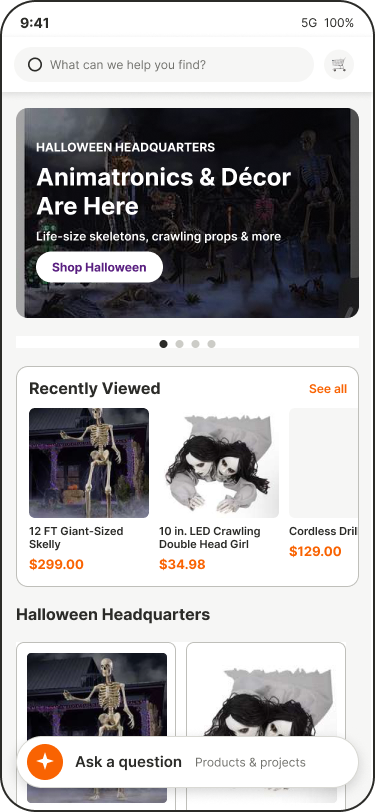
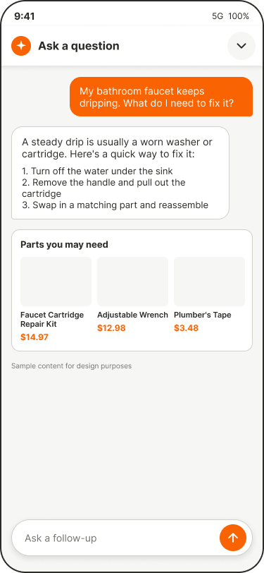

# Home Depot App: Search Visibility Redesign

A clickable prototype of a redesigned Home Depot mobile home screen, built from my Figma design as part of a UI/UX design bootcamp.

**[▶ Try the live prototype](https://georgeosei-fosu.github.io/home-depot-search-redesign/)**. It works best on a phone, or in a desktop browser where it shows inside a phone frame.

> Concept project for learning purposes. Not affiliated with or endorsed by The Home Depot.

| Home | AI assistant | Assistant minimized |
| :---: | :---: | :---: |
|  |  |  |

## The redesign

- **Search always one tap away.** The search bar stays pinned at the top while you scroll, so shoppers never have to scroll back up to find it.
- **Seasonal promo carousel.** Swipe or tap through Halloween, Fall Savings and Appliances promotions.
- **Recently Viewed up front.** Pick up where you left off without searching again.
- **AI assistant for DIY questions.** Ask a project question ("My faucet keeps dripping") and get steps plus the parts you'll need.
- **Conversation stays with you.** Minimizing the assistant keeps the conversation in the bottom bar ("Fixing a dripping faucet · Continue"), so you can browse and come back.

## Try it

| Do this | What happens |
| --- | --- |
| Scroll the home screen | The search bar stays pinned at the top |
| Tap or swipe the promo card | The carousel moves to the next promotion |
| Tap **Ask a question** | The assistant opens with a sample DIY conversation |
| Type a follow-up and send | Your message appears with a placeholder reply |
| Tap **⌄** in the assistant | It minimizes and the bar shows the conversation topic |

The assistant uses sample content. There's no real AI behind it.

## Built with

- [React](https://react.dev/) + [Vite](https://vite.dev/)
- Plain CSS with design tokens taken from the Figma file
- Hosted on GitHub Pages

## Run it locally

You need [Node.js](https://nodejs.org/) installed.

```bash
npm install
npm run dev
```

Then open the address it prints (usually http://localhost:5173).

## Project structure

```
src/
├── App.jsx              # Screen layout and app state (chat open/minimized)
├── data.js              # All text, prices and products: edit content here
├── styles.css           # Styles; colors and sizes from Figma are at the top
├── components/
│   ├── SearchHeader.jsx     # Pinned search bar
│   ├── HeroCarousel.jsx     # Swipeable promo cards
│   ├── RecentlyViewed.jsx
│   ├── ProductCard.jsx
│   ├── ShopByCategory.jsx
│   ├── AssistantBar.jsx     # Docked "Ask a question" bar
│   └── ChatScreen.jsx       # AI assistant conversation
└── assets/              # Photos and icons exported from Figma
```

## Publishing updates

```bash
npm run deploy
```

This builds the site and publishes it to the `gh-pages` branch, which GitHub Pages serves at the live link above.
